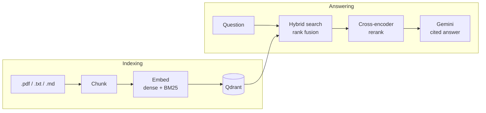

# RAG

A small retrieval-augmented generation service. It searches your documents with hybrid
retrieval, reranks the candidates with a cross-encoder, and has Gemini answer from the
top passages, citing each one it relies on.

It ships with a retrieval benchmark on human-labelled data, so the retrieval choices
below come with numbers you can reproduce in one command.

## How it works



- **Hybrid retrieval.** Every chunk is stored in Qdrant with a dense vector
  (`bge-small-en-v1.5`) and a BM25 sparse vector. A query runs against both, and the two
  rankings are merged with reciprocal rank fusion.
- **Optional reranking.** A cross-encoder (`ms-marco-MiniLM-L-6-v2`) can rescore the
  retrieved candidates against the question. It is off by default, for the reason shown
  in the benchmark.
- **Cited answers.** Gemini receives the top passages as numbered sources and is told to
  answer only from them. The response says which sources were cited.
- **No PyTorch.** All three models run on ONNX Runtime through
  [fastembed](https://github.com/qdrant/fastembed), on CPU.
- **Your own documents.** A Streamlit app lets users sign in, upload PDF, text or
  Markdown files and ask questions about them. Each user's documents, searches and
  history are kept apart.
- **Tested without infrastructure.** The test suite uses embedded Qdrant and fake
  embedders, so it needs no server, no network and no model downloads.

## Benchmark

Retrieval is evaluated on [SciFact](https://github.com/allenai/scifact) as distributed
by the [BEIR](https://github.com/beir-cellar/beir) benchmark: 5,183 scientific abstracts
and 300 test queries, each a scientific claim, with relevance judged by people. Values
are means with 95% bootstrap confidence intervals. Latency covers the whole retrieval
call, including embedding the query, against a Qdrant server on an 8-thread laptop CPU.

| Configuration | nDCG@10 | Recall@10 | MRR@10 | Hit@1 | p50 | p95 |
|---|---|---|---|---|---|---|
| Dense | 0.712 (0.667–0.753) | 0.825 (0.782–0.865) | 0.684 (0.635–0.728) | 0.610 (0.550–0.663) | 13 ms | 18 ms |
| BM25 | 0.679 (0.633–0.722) | 0.804 (0.757–0.846) | 0.646 (0.598–0.692) | 0.557 (0.500–0.610) | 3 ms | 4 ms |
| Hybrid | **0.730** (0.688–0.771) | **0.852** (0.810–0.887) | **0.698** (0.651–0.742) | 0.607 (0.547–0.660) | 15 ms | 22 ms |
| Hybrid + rerank | 0.710 (0.666–0.749) | 0.833 (0.792–0.872) | 0.680 (0.633–0.724) | 0.593 (0.537–0.647) | 2,241 ms | 2,773 ms |

Those intervals overlap because they mostly reflect how much one query differs from
another. Comparing two configurations on the same queries removes that variation:

| Comparison | Δ nDCG@10 | 95% CI |
|---|---|---|
| BM25 vs dense | −0.033 | −0.068 to −0.000 |
| Hybrid vs dense | +0.018 | −0.000 to +0.037 |
| Hybrid + rerank vs dense | −0.002 | −0.032 to +0.028 |
| Hybrid + rerank vs hybrid | −0.021 | −0.047 to +0.007 |

What the numbers support:

- **Hybrid is the best configuration, by a small margin.** It adds about 0.02 nDCG@10 and
  0.03 Recall@10 over dense for 2 ms. The interval for the nDCG gain starts at zero, so
  300 queries are not enough to call it settled. The gain comes from positions two to
  ten: Hit@1 does not improve (0.607 against 0.610).
- **The reranker did not earn its cost.** Rescoring 40 candidates made the ranking
  slightly worse and each query about 150 times slower, which is why reranking is off
  by default. The model was trained on web search queries, and scientific claims are a
  different kind of text; another reranker or corpus may behave differently, so measure
  before turning it on.
- **Dense beats BM25 here**, although BM25 is over four times faster and needs no model.

The full report is in [`results/scifact.md`](results/scifact.md), with per-query scores
in [`results/scifact.json`](results/scifact.json).

### A second dataset: NFCorpus

The same command was then run, with no setting changed, on
[NFCorpus](https://www.cl.uni-heidelberg.de/statnlpgroup/nfcorpus/) from BEIR: 3,633
medical documents and 323 test queries. Queries here are short consumer health topics
with many relevant documents each, so Recall@10 is low for every configuration.

| Configuration | nDCG@10 | Recall@10 | MRR@10 | Hit@1 | p50 | p95 |
|---|---|---|---|---|---|---|
| Dense | 0.348 (0.314–0.384) | 0.165 (0.141–0.192) | 0.536 (0.491–0.585) | 0.446 (0.393–0.501) | 13 ms | 33 ms |
| BM25 | 0.323 (0.291–0.359) | 0.155 (0.129–0.183) | 0.530 (0.484–0.581) | 0.455 (0.406–0.511) | 4 ms | 27 ms |
| Hybrid | **0.365** (0.333–0.402) | **0.178** (0.151–0.207) | 0.573 (0.528–0.621) | 0.486 (0.433–0.542) | 14 ms | 19 ms |
| Hybrid + rerank | 0.364 (0.330–0.400) | 0.172 (0.147–0.200) | **0.590** (0.544–0.638) | **0.514** (0.461–0.567) | 2,141 ms | 2,591 ms |

| Comparison | Δ nDCG@10 | 95% CI |
|---|---|---|
| BM25 vs dense | −0.026 | −0.046 to −0.005 |
| Hybrid vs dense | +0.017 | +0.006 to +0.029 |
| Hybrid + rerank vs dense | +0.015 | −0.001 to +0.031 |
| Hybrid + rerank vs hybrid | −0.001 | −0.014 to +0.010 |

The two datasets agree on the main points:

- **Hybrid gains about 0.02 nDCG@10 over dense on both.** On NFCorpus the paired
  interval excludes zero, which the SciFact interval narrowly failed to do. The fusion
  constant was tuned on SciFact only, so this is the cleaner test of it.
- **Reranking does not improve nDCG@10 on either.** On NFCorpus it leaves nDCG@10
  unchanged while the first result is right more often (Hit@1 0.514 against 0.486, a
  difference that was not tested for significance), at about 150 times the latency.
- **Dense beats BM25 on both.**

This report was produced by a native run on Windows with Python 3.14, the SciFact one
in a Linux container, so compare latencies within a table, not across the two. Full
report: [`results/nfcorpus.md`](results/nfcorpus.md).

### Choosing the fusion constant

Reciprocal rank fusion has one parameter, k. It was chosen on SciFact's train split (809
queries), which plays no part in the tables above. Dense alone scores 0.744 there.

| k | 0 | 1 | 2 | 5 | 10 | 20 | 60 | 100 |
|---|---|---|---|---|---|---|---|---|
| Hybrid nDCG@10, train | 0.7606 | 0.7620 | 0.7625 | 0.7607 | 0.7584 | 0.7560 | 0.7537 | 0.7532 |

The commonly used value of 60 dates from the original RRF paper, which fused many long
rankings. With only two, it lets a chunk that both retrievers rank around 30th beat the
top hit of either. Values from 0 to 5 differ by less than 0.002; the default is 2.

### A finding along the way: ties

Fusing two rankings produces many exact ties, because a chunk found only by one
retriever at rank r scores the same as one found only by the other at rank r. 217 of
the 300 test queries had such a tie inside the top 10. With fusion done by the vector
store, ties were broken arbitrarily: 294 of 300 queries returned a different order on
two consecutive calls, and nDCG@10 drifted between 0.732 and 0.735 from run to run.

Fusion now happens in the service with a fixed tie-break (the dense retriever's
candidate first), so the same query always returns the same order.

### Reproduce

```bash
docker compose up -d qdrant
RAG_QDRANT_URL=http://127.0.0.1:6333 uv run rag eval --dataset scifact

# one point of the sweep
RAG_RRF_K=60 RAG_QDRANT_URL=http://127.0.0.1:6333 uv run rag eval \
  --dataset scifact --split train --configs dense,hybrid --out data/sweep/k60
```

Use `127.0.0.1` rather than `localhost` in the URL. Compose publishes Qdrant on IPv4
only, and on Windows a connection to `localhost` first waits for IPv6 to fail, which
made every request hundreds of times slower.

Indexing the corpus takes 15 to 20 minutes on a laptop CPU. The three configurations
without reranking then finish in seconds, and the reranked one takes about 11 minutes.
A rerun reproduces the quality metrics exactly; latency depends on the hardware. The
committed report came from Python 3.12 in a Linux container, and a run on Windows with
Python 3.14 against the same index matched it on every query for the three
configurations without reranking. Other BEIR datasets use the same command, for example
`--dataset nfcorpus`.

## Quickstart

### Docker Compose

```bash
cp .env.example .env          # add GEMINI_API_KEY to enable answers
docker compose up --build -d  # Qdrant + API

# Index the example documents, or put your own .pdf/.txt/.md files under ./data
mkdir -p data && cp -r examples/docs data/docs
docker compose exec api rag ingest data/docs
```

Open <http://localhost:8000> for the demo page, or call the API:

```bash
curl -s localhost:8000/search -H 'Content-Type: application/json' \
  -d '{"query": "why merge rankings by rank instead of score?"}'

curl -s localhost:8000/ask -H 'Content-Type: application/json' \
  -d '{"question": "Why does hybrid search merge rankings by rank instead of score?"}'
```

The first ingest downloads the models, about 150 MB, into `./data/models`.

### Web app with uploads and sign-in

The compose stack also starts a Streamlit app on <http://localhost:8501>. Out of the
box there is a single local user and nothing else to set up: upload files in the
sidebar and ask questions.

For several users with their own documents, connect a
[Supabase](https://supabase.com) project. It provides sign-in, the PostgreSQL
database for the document list and question history, and private storage for the
uploaded files, while the vectors stay in Qdrant.

1. Put the project's values in `.env`, as described in `.env.example`:
   `RAG_DATABASE_URL` (the *Session pooler* connection string), `SUPABASE_URL`,
   `SUPABASE_ANON_KEY` and `SUPABASE_SERVICE_ROLE_KEY`.
2. Create the tables once: `docker compose run --rm api rag migrate`.
3. Start the stack: `docker compose up --build -d`.

New accounts are created from the app's sign-in page. Supabase asks new users to
confirm their email address unless that is turned off in the project's
authentication settings.

The service key bypasses every access rule, so it is given to the API container
only. The Streamlit container receives just the public URL and anon key.

### Local, with uv

Without `RAG_QDRANT_URL`, Qdrant runs embedded in the process and stores its data in
`data/qdrant`, so nothing else has to be running.

```bash
uv sync
uv run rag ingest examples/docs
uv run rag search "why merge rankings by rank instead of score?"
uv run rag ask "Why does hybrid search merge rankings by rank instead of score?"
uv run rag serve
```

Searching and benchmarking need no API key. `ask` needs a Gemini API key in
`GEMINI_API_KEY`.

## API

| Route | Purpose |
|---|---|
| `POST /search` | Retrieve passages. Body: `query`, optional `mode` (`dense`, `sparse`, `hybrid`), `top_k`, `rerank`. |
| `POST /ask` | Retrieve, then answer with citations. Body: `question`, same options. Each returned source carries a `cited` flag, and `answerable` is false when the sources did not contain the answer. |
| `POST /documents` | Upload a file (`multipart/form-data`, field `file`). It is stored, parsed and indexed for the caller. |
| `GET /documents` | The caller's documents with their status and chunk count. |
| `DELETE /documents/{id}` | Remove a document: its chunks, its stored file and its record. |
| `GET /messages` | The caller's past questions and answers, newest first. |
| `GET /health` | Liveness and the number of indexed chunks. |
| `GET /` | Minimal demo page for the single-user setup. Interactive API docs are at `/docs`. |

With Supabase configured, every route except `/health` and `/` needs
`Authorization: Bearer <access token>` from Supabase Auth, and works only on the
caller's own documents. Uploads arrive as bytes: no route accepts a file path, so the
service never reads a location chosen by a client.

## Configuration

Settings are read from environment variables or `.env`. The main ones:

| Variable | Default | Meaning |
|---|---|---|
| `RAG_QDRANT_URL` | unset | Qdrant server URL. Unset runs Qdrant embedded. |
| `RAG_SEARCH_MODE` | `hybrid` | Default retrieval mode. |
| `RAG_TOP_K` | `5` | Passages returned, and sources given to the model. |
| `RAG_CANDIDATE_K` | `30` | Candidates each retriever contributes, and the pool that is reranked. |
| `RAG_RRF_K` | `2` | Rank fusion constant. Smaller values let top ranks dominate. |
| `RAG_RERANK` | `false` | Rerank by default. A request can still ask for it. |
| `RAG_CHUNK_SIZE` / `RAG_CHUNK_OVERLAP` | `1200` / `150` | Chunking, in characters. |
| `RAG_LLM_MODEL` | `gemini-3.8-flash` | Model that writes the answer. |
| `RAG_DATABASE_URL` | `sqlite:///data/app.db` | Database for the document list and question history. |
| `SUPABASE_URL`, `SUPABASE_ANON_KEY` | unset | Turn on sign-in and per-user data. |
| `SUPABASE_SERVICE_ROLE_KEY` | unset | Keep uploaded files in Supabase Storage instead of `data/uploads`. |
| `RAG_MAX_UPLOAD_MB` | `20` | Largest accepted upload. |
| `RAG_API_KEY` | unset | Single-user setup only: require this value in `X-API-Key`. |

The full list, including the embedding and reranking models, is in
[`src/rag/config.py`](src/rag/config.py).

## Design notes

- **Rank fusion, not score blending.** Cosine similarities and BM25 scores live on
  different scales, and BM25's scale shifts with the query. Reciprocal rank fusion uses
  only positions, so nothing has to be normalised. It runs in the service, on the two
  result lists returned by one batch request, so that ties resolve the same way every
  time.
- **IDF is applied by Qdrant at query time.** Chunks store term frequencies only. The
  inverse document frequency always reflects the current collection, so adding documents
  never leaves stale statistics behind.
- **Indexing is idempotent.** A chunk's id is derived from its document id and position,
  and a document's old chunks are deleted before its new ones are written. Ingesting a
  folder twice changes nothing, and a file that shrank leaves no orphans.
- **Chunks overlap in whole sentences.** Text is split at the coarsest boundary that
  fits (paragraph, line, sentence, word), and the overlap is taken in whole pieces, so a
  chunk never starts mid-sentence.
- **A cross-encoder reranks, not the LLM.** It is deterministic, runs locally, and adds
  no API cost per query, which also keeps the benchmark repeatable.
- **Source text is treated as data.** Passages reach the model inside `<source>` tags,
  with any tag of that name escaped, and the prompt says to ignore instructions found in
  them.
- **Evaluation uses human judgments.** Questions generated by an LLM from a passage tend
  to reuse its wording, which flatters lexical matching. The benchmark uses BEIR
  datasets, where people wrote the queries and judged the documents.

- **Three stores, one source of truth for state.** An uploaded document is a database
  row, a stored file and chunks in Qdrant, with no transaction across them. The row is
  written first as `processing` and becomes `ready` only when the chunks are
  searchable; deletion removes chunks and file before the row. A step that fails
  leaves a row that says so, never chunks that nobody can list or delete.
- **Isolation is enforced where the data is.** The owner filter is applied inside
  Qdrant, and row level security keeps the tables out of Supabase's public REST API,
  so a missing check in a route cannot leak another user's text.

## Limitations

- **Only retrieval is measured.** Whether the generated answers are faithful to their
  sources, and whether the citations are right, is not evaluated. The Gemini call is
  covered by unit tests against a stubbed client, not by a live test.
- **Two small datasets, both of short documents.** SciFact and NFCorpus documents are
  abstracts that mostly fit in one or two chunks, so the benchmark says little about
  chunking long documents, and both corpora are scientific or medical English.
- **English by default.** The embedding model, the BM25 stemmer and stop words, and the
  reranker are all English models. Other languages need other models.
- **Single turn.** There is no conversation memory and no query rewriting.
- **PDFs are read as plain text.** There is no OCR, and tables lose their structure.
- **Embedded Qdrant serves one process.** Use the Qdrant server, as in the compose
  file, when the API and the command line need the index at the same time.
- **Latency comes from one laptop.** Treat it as a ratio between configurations, not as
  a capacity figure.
- **Uploads are indexed while the request waits.** That is fine for documents of a few
  dozen pages on a CPU; large files would need a background job and a progress view.
- **No rate limits or quotas.** Any signed-in user can upload and ask without limit.
- **The upload path through the Streamlit widget is tested by hand.** The API behind
  it is covered by automated tests.

## Development

```bash
uv run pytest                                      # about two seconds, fully offline
uv run ruff check . && uv run ruff format --check .
```

```
src/rag/
  config.py        settings from RAG_* variables
  documents.py     Document, Chunk and Hit
  loaders.py       read .pdf / .txt / .md
  chunking.py      recursive splitting, deterministic chunk ids
  embeddings.py    dense and BM25 embedders
  rerank.py        cross-encoder
  store.py         Qdrant collection: dense, sparse and hybrid search
  fusion.py        reciprocal rank fusion with a fixed tie-break
  pipeline.py      Indexer and Retriever
  generate.py      prompt, Gemini call, citation extraction
  db.py            documents and messages tables, migrations entry point
  auth.py          who is calling, verified against Supabase Auth
  storage.py       original files: Supabase Storage or a local directory
  library.py       add, list and delete a user's documents across the three stores
  migrations/      Alembic migrations, run by `rag migrate`
  services.py      builds the pipeline from settings
  api.py           FastAPI app
  cli.py           ingest / search / ask / serve / migrate / eval
  eval/            BEIR loader, metrics, benchmark runner
ui/app.py          Streamlit app: sign in, upload, ask
tests/             fakes in conftest.py, one test module per source module
results/           benchmark output committed with the code that produced it
```

On Windows machines with Smart App Control enabled, the gRPC binary that `qdrant-client`
imports may be blocked. Run the tools in the dev image instead:

```bash
docker build --target dev -t rag-dev .
docker run --rm -v "${PWD}:/app" rag-dev pytest
```
