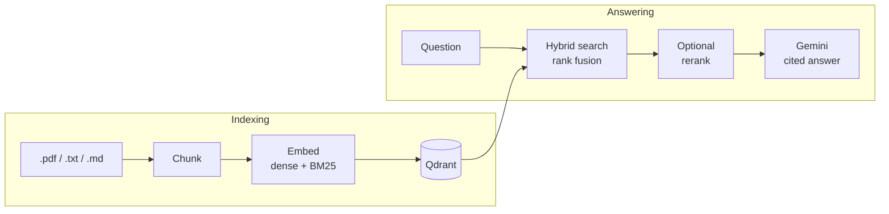

# RAG

A retrieval-augmented generation service for your own documents. Users sign in, upload
PDF, text or Markdown files, and ask questions; answers come from Gemini and cite the
passages they rely on. Retrieval is hybrid (dense + BM25) and was chosen by measurement:
the repository includes a benchmark on human-labelled data that reproduces every number
below.

## How it works



| Part | Technology |
|---|---|
| API | FastAPI |
| Vectors | Qdrant, one dense (`bge-small-en-v1.5`) and one BM25 sparse vector per chunk |
| Fusion and reranking | Reciprocal rank fusion; optional cross-encoder (`ms-marco-MiniLM-L-6-v2`) |
| Models | ONNX Runtime on CPU through fastembed, no PyTorch |
| Answers | Gemini, constrained to the retrieved passages, with numbered citations |
| Users, document list, history, files | Supabase: Auth, PostgreSQL and Storage |
| Front end | Streamlit |

Each user's documents, searches and history are kept apart: the owner filter is applied
inside Qdrant, and row level security keeps the tables out of Supabase's public API.

## Benchmark

Retrieval is measured on two [BEIR](https://github.com/beir-cellar/beir) datasets with
relevance judged by people. Values are nDCG@10 with 95% bootstrap confidence intervals;
latency is the median for the whole retrieval call on a laptop CPU.

| Configuration | SciFact (300 queries) | NFCorpus (323 queries) | Latency |
|---|---|---|---|
| Dense | 0.712 (0.667–0.753) | 0.348 (0.314–0.384) | 13 ms |
| BM25 | 0.679 (0.633–0.722) | 0.323 (0.291–0.359) | 3 ms |
| Hybrid | **0.730** (0.688–0.771) | **0.365** (0.333–0.402) | 15 ms |
| Hybrid + rerank | 0.710 (0.666–0.749) | 0.364 (0.330–0.400) | 2,241 ms |

Paired differences over the same queries:

| Comparison | SciFact | NFCorpus |
|---|---|---|
| Hybrid vs dense | +0.018 (−0.000 to +0.037) | +0.017 (+0.006 to +0.029) |
| Hybrid + rerank vs hybrid | −0.021 (−0.047 to +0.007) | −0.001 (−0.014 to +0.010) |

- **Hybrid gains about 0.02 nDCG@10 over dense on both datasets.** The paired interval
  excludes zero on NFCorpus and narrowly includes it on SciFact.
- **Reranking does not improve nDCG@10 on either**, at about 150 times the latency, so
  it is off by default.
- **The fusion constant was chosen on SciFact's train split** (809 queries) and reported
  on the test splits. On train, nDCG@10 fell from 0.7625 at k=2 to 0.7537 at the
  commonly used k=60.
- **Rank fusion runs in the service with a fixed tie-break.** With fusion done by the
  vector store, exact ties were broken arbitrarily and 294 of 300 queries returned a
  different order on consecutive calls.

Full reports with per-query scores are in [`results/`](results/). Reproduce with:

```bash
docker compose up -d qdrant
RAG_QDRANT_URL=http://127.0.0.1:6333 uv run rag eval --dataset scifact
```

## Quickstart

```bash
cp .env.example .env          # add GEMINI_API_KEY
docker compose up --build -d  # Qdrant, API and the Streamlit app
```

Open <http://localhost:8501>, upload files in the sidebar and ask questions. Without
further setup there is a single local user.

### Several users with Supabase

1. Create a [Supabase](https://supabase.com) project and put its values in `.env`:
   `RAG_DATABASE_URL` (the *Session pooler* connection string), `SUPABASE_URL`,
   `SUPABASE_ANON_KEY` and `SUPABASE_SERVICE_ROLE_KEY`.
2. Create the tables once: `docker compose run --rm api rag migrate`.
3. Restart the stack: `docker compose up --build -d`.

Accounts are created from the app's sign-in page. The service key bypasses every access
rule, so only the API container receives it.

### Command line

Without `RAG_QDRANT_URL`, Qdrant runs embedded in the process, so nothing else has to be
running.

```bash
uv sync
uv run rag ingest examples/docs
uv run rag search "why merge rankings by rank instead of score?"
uv run rag ask "Why does hybrid search merge rankings by rank instead of score?"
```

## API

| Route | Purpose |
|---|---|
| `POST /documents` | Upload a file (`multipart/form-data`, field `file`); it is stored, parsed and indexed for the caller. |
| `GET /documents` | The caller's documents with status and chunk count. |
| `DELETE /documents/{id}` | Remove a document: its chunks, its stored file and its record. |
| `POST /search` | Retrieve passages. Body: `query`, optional `mode` (`dense`, `sparse`, `hybrid`), `top_k`, `rerank`. |
| `POST /ask` | Retrieve, then answer with citations. Each source carries a `cited` flag; `answerable` is false when the sources lack the answer. |
| `GET /messages` | The caller's past questions and answers. |
| `GET /health` | Liveness and the number of indexed chunks. |

With Supabase configured, every route except `/health` needs
`Authorization: Bearer <access token>`. Interactive documentation is at `/docs`.

## Configuration

Settings come from environment variables or `.env`. The main ones:

| Variable | Default | Meaning |
|---|---|---|
| `GEMINI_API_KEY` | unset | Needed for answers; search and the benchmark run without it. |
| `RAG_QDRANT_URL` | unset | Qdrant server URL. Unset runs Qdrant embedded. |
| `RAG_DATABASE_URL` | `sqlite:///data/app.db` | Database for the document list and history. |
| `SUPABASE_URL`, `SUPABASE_ANON_KEY` | unset | Turn on sign-in and per-user data. |
| `SUPABASE_SERVICE_ROLE_KEY` | unset | Keep uploaded files in Supabase Storage. |
| `RAG_SEARCH_MODE` | `hybrid` | Default retrieval mode. |
| `RAG_TOP_K` | `5` | Passages returned and given to the model. |
| `RAG_RERANK` | `false` | Rerank by default. |
| `RAG_LLM_MODEL` | `gemini-3.8-flash` | Model that writes the answer. |
| `RAG_MAX_UPLOAD_MB` | `20` | Largest accepted upload. |

The full list is in [`src/rag/config.py`](src/rag/config.py).

## Development

```bash
uv run pytest                                      # a few seconds, fully offline
uv run ruff check . && uv run ruff format --check .
```

Tests use embedded Qdrant, SQLite in memory and fake embedders, so they need no server,
no network and no model downloads.

```
src/rag/
  config.py, services.py     settings and wiring
  loaders.py, chunking.py    read files, split into chunks
  embeddings.py, rerank.py   dense, BM25 and cross-encoder models
  store.py, fusion.py        Qdrant search and rank fusion
  pipeline.py                Indexer and Retriever
  generate.py                prompt, Gemini call, citations
  db.py, migrations/         documents and messages tables
  auth.py, storage.py        Supabase sign-in and file storage
  library.py                 add, list and delete a user's documents
  api.py, cli.py             FastAPI app and command line
  eval/                      BEIR loader, metrics, benchmark runner
ui/app.py                    Streamlit app
results/                     committed benchmark reports
```
